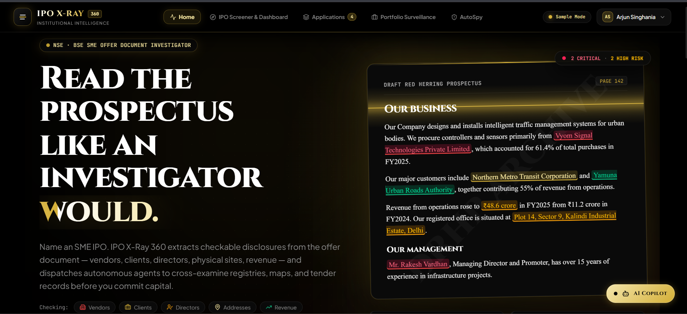
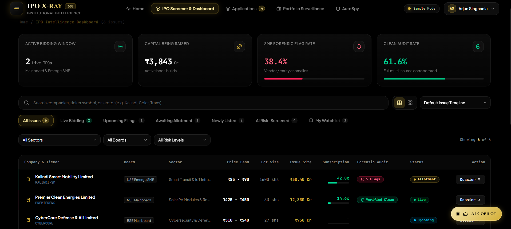
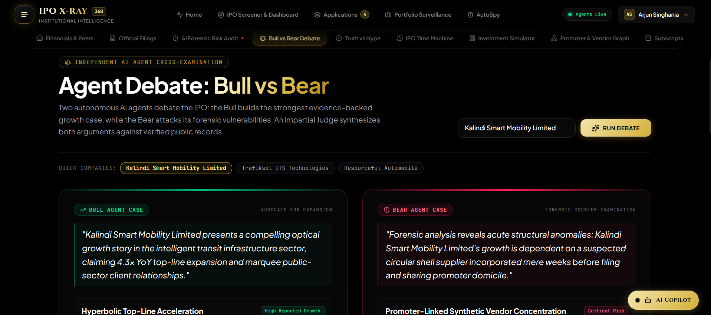
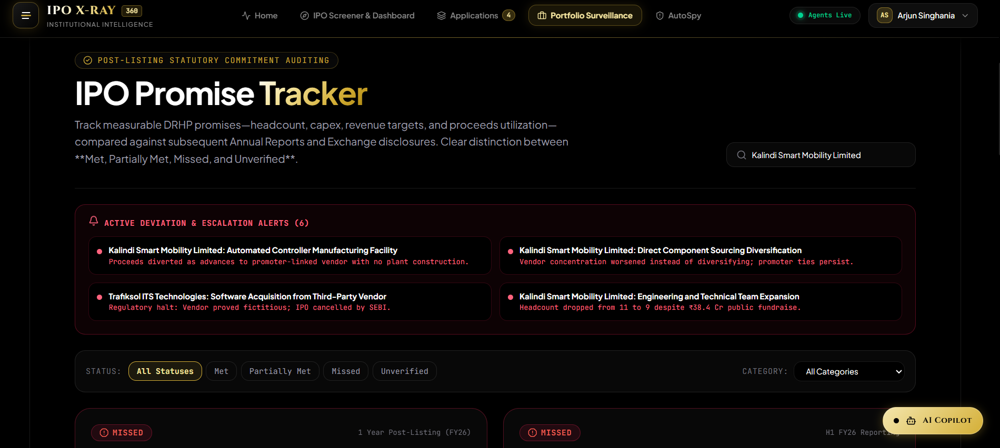
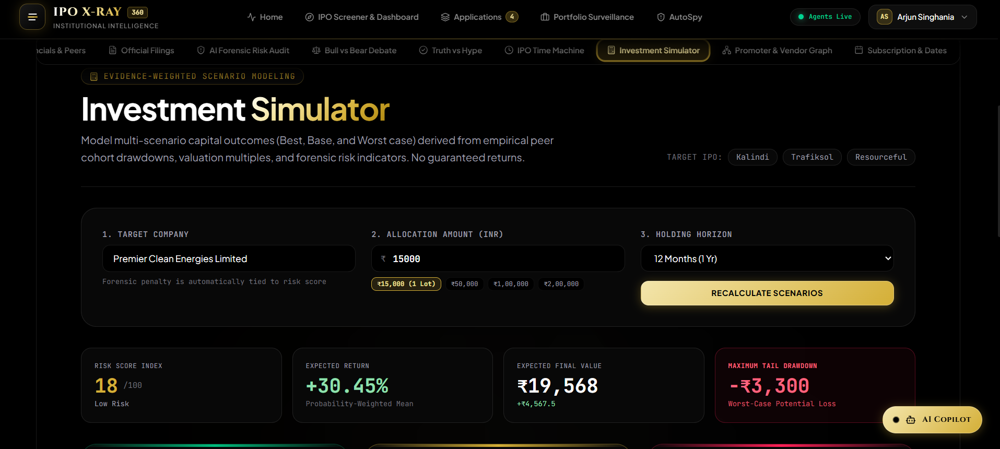
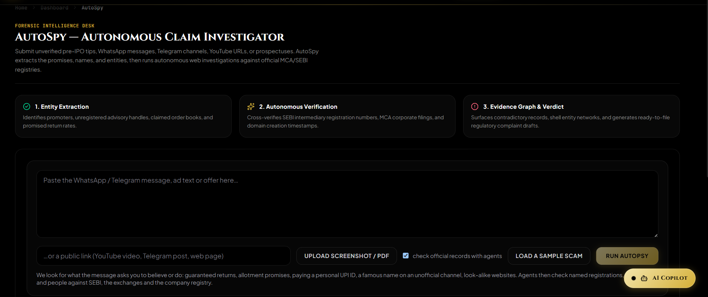
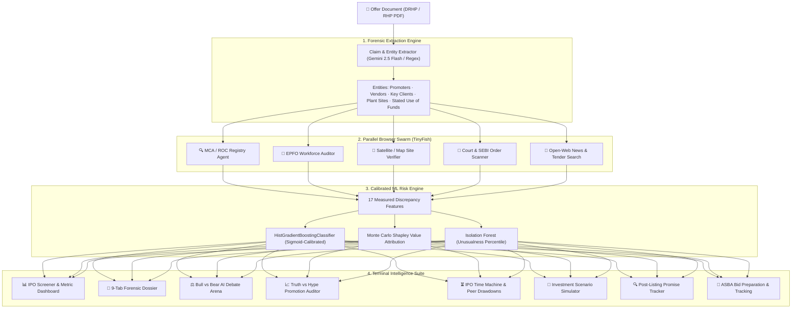

<div align="center">

# 🏛️ IPO X-RAY 360
### Institutional-Grade SME & Mainboard IPO Forensic Intelligence Platform

[](https://ipo-xray-360.vercel.app)
[](https://youtu.be/your-demo-video)
[](https://linkedin.com/in/your-profile)
[](https://opensource.org/licenses/MIT)
[](https://fastapi.tiangolo.com)
[](https://react.dev)

<p align="center">
  <b>Read the prospectus like a forensic investigator would before you commit capital.</b><br/>
  Autonomous web agents, ROC/MCA registry cross-examination, calibrated gradient-boosted risk modeling, post-listing commitment auditing, and interactive investor intelligence in a unified private-wealth terminal.
</p>

---

[🌐 Live Hosted App](https://ipo-xray-360.vercel.app) • [🎬 Watch 3-Min Video Demo](https://youtu.be/your-demo-video) • [💼 Read LinkedIn Announcement](https://linkedin.com/in/your-profile) • [📑 Documentation](#-multi-agent-forensic-architecture)

---

</div>

## 📌 Visual Showcase & Platform Tour

<div align="center">

### 1. High-Conviction Landing Page & DRHP Investigator Hero
*Autonomous agent radar cross-examining offer documents before capital is deployed.*
<br/>

<a href="./public/a.png">
  
</a>

<br/><br/>

### 2. Institutional IPO Screener & Metrics Dashboard (`/dashboard`)
*Live bidding tracker, issue timelines, capital-raised telemetry, and forensic flag rates.*
<br/>

<a href="./public/b.png">
  
</a>

<br/><br/>

| 3. Bull vs Bear AI Debate Arena | 4. Post-Listing IPO Promise Tracker |
| :---: | :---: |
| <a href="./public/c.png"></a> | <a href="./public/d.png"></a> |
| *Evidence-grounded Bull & Bear theses synthesized by an Impartial Judge.* | *Audits stated DRHP proceeds utilization against subsequent Annual Reports.* |

| 5. Evidence-Weighted Investment Simulator | 6. AutoSpy — Autonomous Claim Investigator |
| :---: | :---: |
| <a href="./public/e.png"></a> | <a href="./public/f.png"></a> |
| *Probability-weighted capital outcomes factoring in peer drawdown history.* | *Forensic scrutiny of unverified stock tips, WhatsApp forwards & YouTube claims.* |

</div>

---

## ⚡ The Core Problem

India’s SME and Mainboard IPO markets have experienced unprecedented retail exuberance. Beneath astronomical subscription multiples often lie:
* **Circular Shell Vendors:** Undisclosed related parties sharing registered addresses or directors with promoters.
* **Paper Client Rosters:** Mega contracts with entities that have no commercial web presence or never acknowledge the issuer.
* **Phantom Employees:** Triple-digit revenue surges reported with single-digit EPFO-registered workforces.
* **Post-Listing Disappearance:** Funds raised for expansion diverted away from stated DRHP objectives.

**IPO X-Ray 360** transforms offer documents from static, 400-page marketing PDFs into machine-scrutinized evidentiary findings backed by verifiable public records.

---

## 🔬 Multi-Agent Forensic Architecture



---

## 🌟 Key Modules & Capabilities

### 1. 🏛️ High-Conviction Landing Page (`/`)
* **"Read the prospectus like an investigator would"** — terminal hero featuring an interactive DRHP document reader, live agent telemetry, and sample scam autopsy cases.
* Direct search bar for SME issuer names or PDF DRHP uploads.
* Instant redirect into the complete IPO Screener via the primary **"Start investigation"** CTA.

### 2. 📊 IPO Screener & Metrics Dashboard (`/dashboard`)
* Filter across **Live Bidding**, **Upcoming Filings**, **Closed / Allotment Awaited**, and **Newly Listed** issues.
* Granular filters by Sector, Listing Board (NSE Emerge, BSE SME, Mainboard), and Forensic Risk Level.
* Dual-view mode: Institutional Data Table vs Executive Card Grid with real-time subscription meters and capital-raised telemetry.
* Direct URL query sync (`/dashboard?q=Kalindi`).

### 3. 📑 9-Tab Forensic Dossier (`/ipo/:symbol`)
Every company profile is backed by an in-depth intelligence dossier:
1. **Financials & Peers:** Capital structure, price bands, lot size, financial highlights, peer multiples, and subscription status.
2. **Official Filings:** Download links for DRHP, RHP, and exchange notices with origin verification.
3. **AI Forensic Risk Audit:** Explainable risk scores with Shapley points breakdown and supporting source links.
4. **Bull vs Bear Debate:** Independent Bull agent builds the strongest growth thesis; Bear attacks forensic vulnerabilities; Impartial Judge delivers evidence-grounded synthesis.
5. **Truth vs Hype:** Backtests social media tips / telegram calls against actual market prices after transaction fees & Nifty 50 benchmarks.
6. **IPO Time Machine:** Evaluates historically comparable listing drawdowns, valuation multiples, and liquidity traps.
7. **Investment Simulator:** Monte-Carlo capital modeling (Best, Base, and Worst cases) factoring in tail-risk drawdowns.
8. **Promoter & Vendor Graph:** Interactive `vis-network` graph displaying shared directors, identical addresses, and circular supplier loops.
9. **Subscription & Dates:** Detailed issue schedules, refund dates, and official registrar allotment lookups.

### 4. 📝 ASBA Bid Preparation & Application Tracking (`/applications`)
* Bid calculator computing retail & HNI lot multiples, cut-off prices, and capital requirements.
* Strict compliance: **Never collects sensitive UPI PINs or banking credentials**; prepares verified ASBA instructions and routes to official broker/bank channels.
* Lifecycle tracking from Draft to Allotted, Partially Allotted, or Refunded.

### 5. 🔍 Post-Listing Promise Tracker (`/portfolio`)
* Continuously audits DRHP commitments (headcount targets, plant capex, debt retirement) against subsequent Annual Reports and MCA filings.
* Categorizes commitments into **Met**, **Partially Met**, **Missed**, and **Unverified**.
* Escalates alerts when proceeds deviation exceeds allowable regulatory thresholds.

### 6. 🕵️ AutoSpy Autonomous Tip Investigator (`/autospy`)
* Ingests unverified stock tips, WhatsApp forwards, YouTube videos, or unlisted shares offers.
* Autonomous agents extract promoter names, registration numbers, and financial promises to verify legitimacy against SEBI records.

### 7. 🤖 Context-Aware Financial Copilot
* Embedded AI analyst drawer grounded in official DRHP text and public registry evidence.
* Cites page numbers and statutory sources; refuses speculation or return guarantees.

---

## 🛠️ Technology Stack

| Layer | Technologies |
|---|---|
| **Frontend** | React 19, Vite, Tailwind CSS, Framer Motion, Lucide Icons, Vis-Network |
| **Typography** | `Cinzel` (Luxury Display), `Plus Jakarta Sans` (UI Sans), `Playfair Display` (Editorial Serif), `JetBrains Mono` (Financial Telemetry) |
| **Backend** | Python 3.11+, FastAPI, Uvicorn, SQLite3, Server-Sent Events (SSE) |
| **Machine Learning** | Scikit-learn (`HistGradientBoostingClassifier`, `IsolationForest`), Joblib |
| **Agentic Web AI** | TinyFish Autonomous Browser Swarm, Google Gemini 2.5 Flash / Pro |
| **Knowledge Graph** | Graphify (AST symbol mapping, 1,050+ nodes, 2,670+ dependency edges) |

---

## 🚀 Quick Start Guide

### Prerequisites
* Python 3.10+ installed
* Node.js 18+ (Node 20+ recommended)
* Optional: [TinyFish API Key](https://tinyfish.ai) (for live browser agents; simulated offline mode works out of the box)
* Optional: `GEMINI_API_KEY` (for generative DRHP text extraction)

### 1. Backend Setup
```bash
# Clone the repository
git clone https://github.com/your-username/ipo-xray.git
cd ipo-xray/backend

# Create and activate virtual environment
python -m venv .venv
source .venv/bin/activate       # On Windows: .venv\Scripts\activate

# Install dependencies
pip install -r requirements.txt

# Configure environment variables
cp .env.example .env            # Add your API keys if available

# Launch the FastAPI backend server
uvicorn main:app --reload --port 8000
```

### 2. Frontend Setup
```bash
# In a new terminal window
cd ../frontend

# Install dependencies
npm install

# Start Vite development server
npm run dev
```

Visit **`http://localhost:5173`** in your browser. (The dev server proxies `/api` requests seamlessly to `http://localhost:8000`).

---

## 🧪 Automated Testing

Run the end-to-end backend test suite verifying the database, ML inference, simulator, promise tracker, debate engine, and copilot:

```bash
cd backend
python -m unittest test_features.py -v
```

---

## ⚖️ Regulatory Disclaimer & Ethics

> [!IMPORTANT]
> **IPO X-Ray 360** is an open-source forensic intelligence research tool. It is **not** a SEBI-registered investment advisor or stock broker. 
> * The platform does not guarantee IPO allotment or predict stock market gains.
> * Application preparation is educational and routes to official bank ASBA/broker channels; no banking passwords or UPI PINs are ever captured or stored.
> * Every forensic finding is cited with verifiable public records (DRHP page citations, MCA filings, court dockets, or tender archives).

---

## 🤝 Contributing & Community

Contributions are warmly welcomed! Please read [`AGENTS.md`](./AGENTS.md) before submitting pull requests (our repo enforces continuous AST symbol auditing with `graphify`).

```bash
# Sync codebase knowledge graph
python -m graphify update
```

<div align="center">
  <sub>Crafted for transparent, evidence-backed IPO investing.</sub><br/>
  <b>© 2026 IPO X-Ray 360. All rights reserved.</b>
</div>
